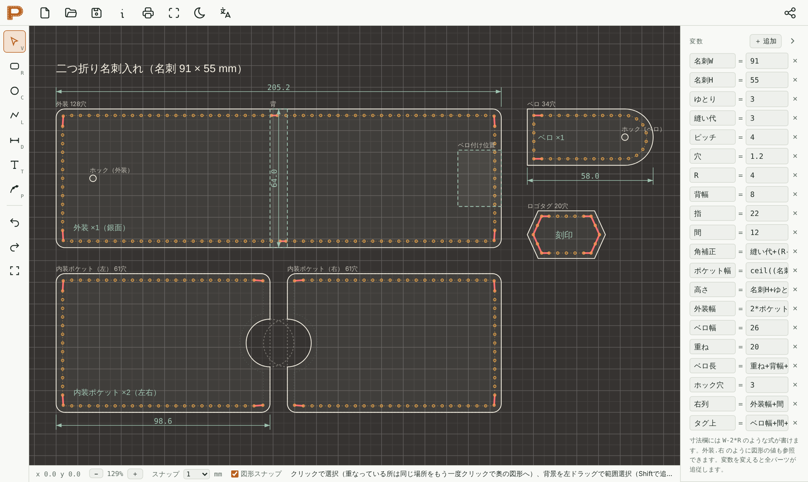
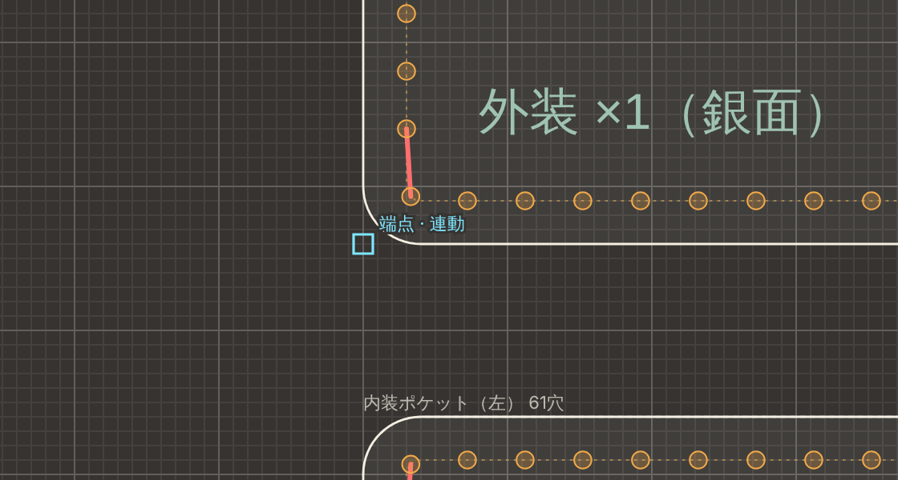
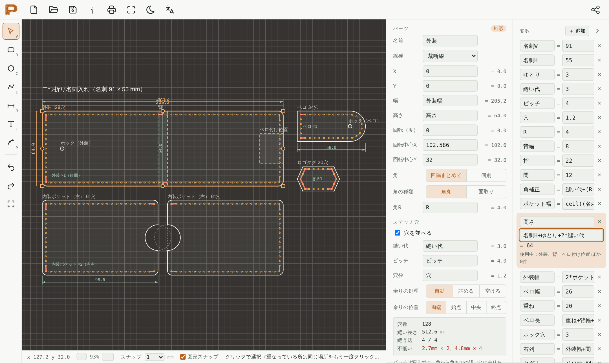
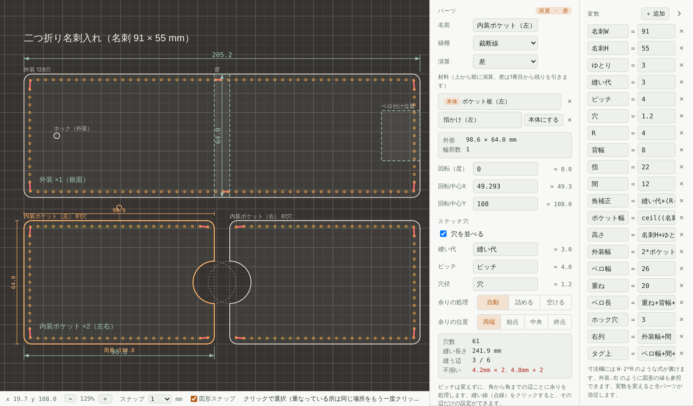
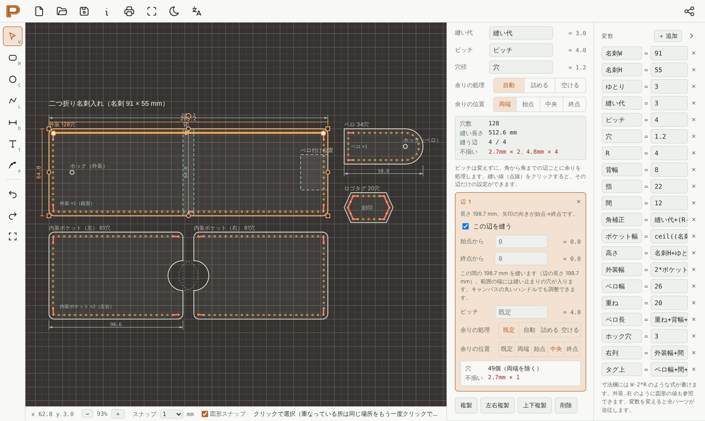
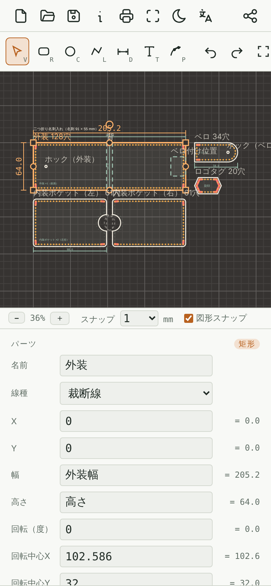
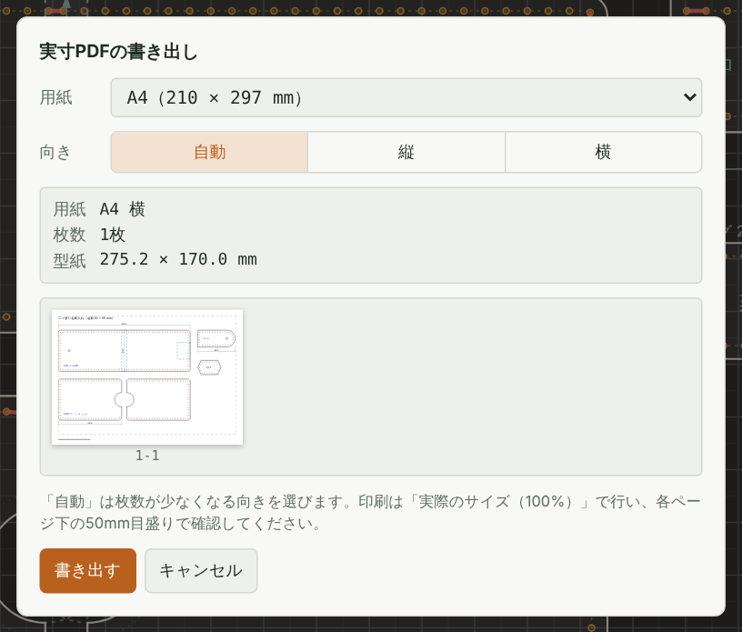
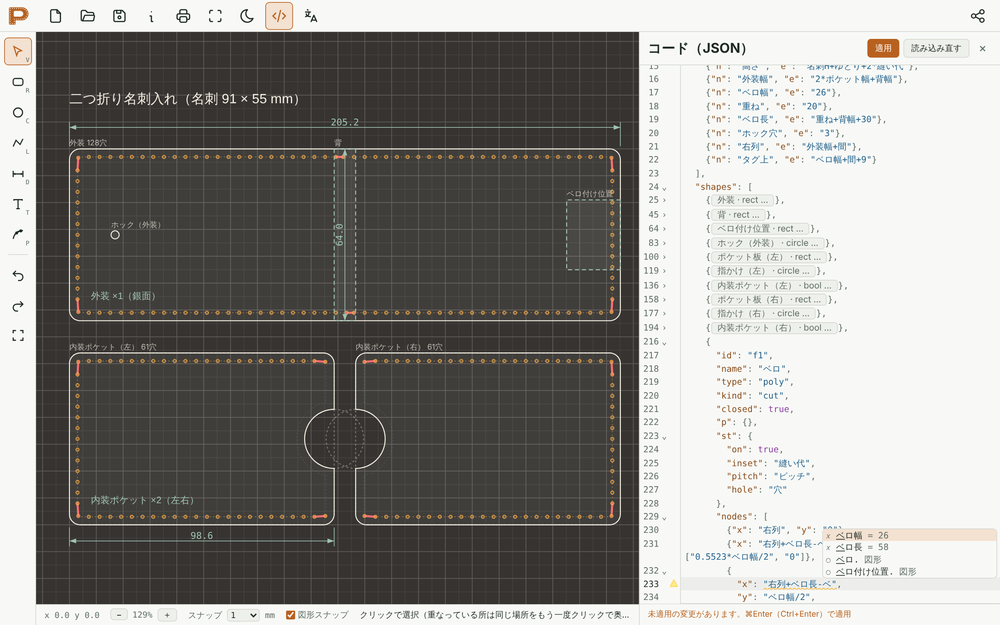

# Parametric Pattern Plotter（PPP）

式で描くレザークラフト型紙CAD。寸法を変数と式で書けるパラメトリックな2D CADです。
`index.html` を1つ開くだけで動きます（インストール不要）。

**▶ ブラウザで使う：https://amber-color.github.io/parametric-pattern-plotter/**

## できること

- **作図**：矩形・円・直線（折れ線）・ベジェ曲線。グリッドスナップ（0.5 / 1 / 5 mm）
- **回転**：矩形・パス・演算結果を回転できます。パネルの「回転（度）」に角度（式も可）を入れるか、選択中の図形の上に出る丸いハンドルをドラッグ（Shiftで15°刻み）。時計回りが正です
  - 回転中心は「回転中心X・Y」で指定。最初に回したときの図形の中心が自動で入ります。移動すると回転中心もついてきます
  - 回転した図形にもステッチ穴・辺ごとの設定・書き出し（SVG・DXF・PDF）がそのまま効きます。回転した矩形はキャンバスの伸縮ハンドルが出ないので、寸法はパネルで編集します
  - 回転した図形への図形スナップは、吸着はしますが数値で入ります（連動しません）
  - 演算結果を回したとき、材料は回転前の位置に表示されます
- **図形スナップ**：作図・移動・ハンドル操作のとき、ほかの図形の点に吸着します。吸着先は水色の印と名前で表示
  - 端点（□）・中点（△）・中心（○）・円の四分点（◇）・交点（×）・線上（⧖）、図形の点と水平・垂直にそろう延長線（点線）
  - 図形の角を持ってドラッグすると、その角を基準に吸着（例：ポケットの右上の角を外装の右上の角に合わせる）
  - ステータスバーの「図形スナップ」か `S` キーで切り替え。`Ctrl` / `⌘` を押している間は一時的に吸着しません
- **連動スナップ**：図形の点に吸着すると、座標が数値ではなく `外装.右` のような**その図形を参照する式**で書き込まれます。参照先の図形が変数で動けば、吸着した図形・寸法線・頂点もついてきます（表示は「端点 · 連動」）
  - 矩形の片側の角だけが吸着したときは、その角に付いたまま大きさを保ちます。両側が吸着すると、その間に張ります
  - 延長線（そろえるだけ）の吸着は参照を作らず、数値になります
  - 参照先の図形を削除しようとすると、どこから参照されているかを表示して止めます。図形の名前を変えると参照も書き換わります

- **寸法線**：寸法線ツールで始点と終点をクリックし、線の位置を決めてもう一度クリック。図形の点に吸着すると連動スナップで参照式が入るので、変数で図形が変わっても寸法線が追従する。PDF・SVGでは線と数値を、DXFではDIMレイヤーに線と文字を出力
- **テキスト**：テキストツールでクリックした位置に文字を配置。文字・高さ・回転をパネルで編集でき、位置や高さにも式が書ける。PDFでは日本語もそのまま印刷でき、SVGは文字要素、DXFはTEXTレイヤーに出力
- **矩形の角**：四隅まとめて、または角ごとに、角丸（R）・面取り（C）・なしを選び、大きさを式で指定。DXFでは角丸を正確な円弧、面取りを直線で出力
- **ベジェ曲線**：ベジェツールでクリックすると角の点、ドラッグすると曲線の点。頂点のダブルクリックで角⇔曲線の切り替え、線上のダブルクリックで頂点を追加。頂点をクリックで選択（Shiftで追加選択）し、Deleteで削除。ハンドルはドラッグで調整（Altで左右を独立）
- **寸法を式で書ける**：`W`、`2*H`、`W+間` のように変数と式で寸法を指定。パスの頂点座標とハンドルにも式が書ける。変数を変えると全パーツが追従

- **ブーリアン演算（非破壊）**：Shift＋クリックで複数選択し、合体・差・交差・排他。元の図形は「材料」として式付きのまま残り、変数を変えると演算結果も作り直される。「確定」で座標を固定、「演算を解除」で元の図形に戻せる。演算結果をさらに演算の材料にすることも可能

- **ステッチ穴の自動配置**：縫い代（縁から縫い線までの距離）・ピッチ・穴径を指定すると、縫い線を内側にオフセットして穴を配置。ピッチは変えず、角（30°以上の折れ。矩形の角丸・面取りはその中央）で区切った辺ごとに、角に必ず穴を置く
  - 余りの処理：自動（ずれが小さいほう）・詰める（短い間隔を1つ作る）・空ける（長い間隔を1つ作る）
  - 余りの位置：両端（余りを半分ずつ両端へ）・始点・中央・終点
  - 縫い線（点線）をクリックするとその辺を選べて、縫う／縫わない、ピッチ、余りの処理、余りの位置を辺ごとに上書きできる
  - 辺ごとの設定は辺の位置で記憶するので、頂点を足す・角の種類を変える・変数で形を変えるなどしても、同じ辺に付いたまま残る（形が大きく変わってどの辺にも当てはまらなくなった設定は、パネルに件数を表示）
  - 辺の一部だけ縫う：「始点から」「終点から」の距離（mm、式も可）で縫う範囲を指定。範囲の端には縫い止まりの穴が入る。キャンバスのハンドルでも調整できる
  - 指定ピッチと違う間隔は赤で表示し、パネルにその寸法と数を表示

- **画面構成**：右側にパーツ欄と変数バーを横に並べて表示。パーツ欄は図形を選んでいるときだけ出る。変数バーは右上のボタンで折りたためる。スマホでは1画面に収まり、上半分が図面、下半分が選んだパーツの欄（何も選んでいないときは変数）になる

- **書き出し**
  - 上部バーの書き出しアイコンを押して、PDF・SVG・DXFをメニューから選ぶ
  - 実寸PDF：書き出し前に各ページのプレビューを表示。用紙（A3・A4・A5・B4・B5・レター、または図形に合わせた1枚）と向き（自動・縦・横）を選んで書き出し。用紙より大きい型紙は自動で分割し、各ページに50mmの確認目盛りと貼り合わせ用トンボ
  - SVG：mm単位、裁断線 / ステッチ穴 / ガイドをグループ分け
  - DXF（R12）：レイヤー `CUT` / `STITCH` / `GUIDE`。角丸はバルジ付きポリラインで正確な円弧。ベジェ曲線はR12に無いため細かい折れ線で出力
  - SVG・PDFではベジェ曲線をそのまま出力

- **コード（JSON）で編集**：上部バーの `</>` アイコンで、型紙全体をJSONとして直接編集できます（パーツ欄と変数バーの代わりに右側に開き、スマホでは下半分）
  - 書き換えて「適用」（`⌘Enter` / `Ctrl+Enter`）で図面に反映。`⌘Z` で適用前に戻せます。JSONの誤りや、図形の種類の間違い・IDの重複などがあると適用しません
  - 色分け表示、変数・図形・図形の値（`外装.` のあと）・関数の自動補完（`Ctrl+Space` でも呼び出し）、`"type"` などの決まった値の補完
  - 式の書き間違いは赤、存在しない変数や図形は黄色の印で、書いている途中から表示
  - キャンバスで図形を選ぶと、その図形の行に色が付いてスクロール。書き換えていない間は、図面の変更がコードにも反映されます
  - 開いたとき・適用したとき・読み込み直したときは自動で整形。変数は1行に1つ、図形はキーごとに1行（頂点や辺ごとの設定など短いものは1行にまとめる）
  - 行番号の横の ⌄ で図形ごとに折りたため、畳んだ図形は「外装 · rect …」のように名前と種類を表示。適用や図面の変更で書き直されても畳んだまま
  - CodeMirror の機能：`⌘F` で検索・置換、括弧の対応表示、`Alt` ＋クリックで複数カーソル

- **共有**：上部バーの共有ボタンで、型紙をまるごと埋め込んだURL（`#p=` 以降に圧縮して格納）をクリップボードにコピー。開くとその型紙が読み込まれる（サーバーには何も送らない）
- **日本語 / English**：画面の言語はブラウザの言語設定で自動で決まります。上部バーの文字のアイコンで切り替えられ、選んだ言語を覚えます（切り替えると再読み込みします。型紙は保存されたまま）。使い方（このページ）とサンプルは日本語のままです
- **ライト / ダーク**：上部バーの月・太陽のアイコンで切り替え。最初はOSの設定に従い、切り替えるとその選択を覚えます
- **印刷枠**：上部バーの四隅のかぎ型のアイコン（書き出しの右）で、PDFの用紙と向きで印刷される範囲を図面上に表示
- **保存**：作業中の型紙はブラウザに自動保存。上部バーの保存・開くボタンで `.json` の保存・読み込みも可能

## 使い方

| 操作 | キー |
|---|---|
| 選択・移動 | `V`（Shift＋クリックで複数選択。重なっているときは小さい図形・線をクリックした図形が優先され、同じ場所をもう一度クリックすると奥の図形に切り替わる） |
| 式の位置を動かす確認 | 位置が式で決まっているパーツをドラッグで動かすと、離したときに確認が出る（「元に戻す」で取り消し。「次から確認しない」を選ぶと以後は出ない） |
| 範囲選択 | 背景を左ドラッグ（タッチ操作は1本指ドラッグ。枠に完全に入った図形を選択、Shiftで追加） |
| 矩形 | `R`（Shiftで正方形） |
| 円 | `C` |
| 直線・折れ線 | `L`（クリックで頂点。始点クリックで閉じる、ダブルクリックかEnterで終了、Shiftで水平垂直）。描いたあと、開いた線の端の頂点をShift＋ドラッグすると、端の線分の向きのまま延長・短縮（長さはスナップの刻み） |
| 寸法線 | `D`（始点→終点→線の位置の順にクリック） |
| テキスト | `T`（クリックで配置。ダブルクリックで文字を編集） |
| ベジェ曲線 | `P`（クリックで角、ドラッグで曲線。終了・閉じ方は折れ線と同じ） |
| 全体表示 | `F` |
| 図形スナップの切り替え | `S`（`Ctrl` / `⌘` を押している間は一時的に無効） |
| 元に戻す / やり直し | `⌘Z` / `⇧⌘Z` |
| 複製 | `⌘D`。パネルの「左右複製」「上下複製」で、左右・上下に反転した形を右・下に複製（式は式のまま反転。辺ごとのステッチ設定も反転先の辺に付く） |
| 削除 | `Delete` |
| 画面移動 | 右ドラッグ、中ボタンドラッグ、Space＋ドラッグ（タッチ操作は2本指ドラッグ） |
| 拡大縮小 | ホイール（タッチ操作はピンチ） |

### 式で使えるもの

`+ - * / ^ ( )`、`sqrt` `abs` `min` `max` `round` `floor` `ceil`、`sin` `cos` `tan` `atan`（度）、`pi`。
変数名には日本語も使えます（例：`縫い代 = 3`）。数字のあとに文字が続く名前なら、数字で始めても構いません（例：`500円玉直径 = 26.5`）。数字だけの名前、空白や記号（`+ - * / ( )` など）を含む名前、関数名（`sqrt` など）、ほかの変数と同じ名前は使えず、入力中は赤く表示され、欄を離れると元の名前に戻ります。

図形の値も参照できます：`図形名.値`。名前に記号や空白を含む図形は `[内装ポケット（左）].上` のように角かっこで囲みます。

| 値 | 意味 |
|---|---|
| `左` `右` `上` `下` | 外形（バウンディングボックス）の端の座標 |
| `幅` `高さ` `中心X` `中心Y` | 外形の大きさと中心 |
| `X` `Y` | 矩形の左上、テキストの基準点 |
| `直径` `半径` | 円 |
| `点1X` `点1Y` … | パスの頂点（1から数える） |
| `始点X` `終点Y` `長さ` など | 寸法線 |

図形の欄では、その図形自身の値を `自分.値` で使えます（値の名前は上の表と同じ。回転した図形では回転前の値）。
- 角R・縫い代・ピッチ・縫う範囲・回転中心など：`自分.幅/2`（横幅の半分の角R）、`自分.中心X`（回転の中心を常に図形の中心に）
- 寸法どうし：高さに `自分.幅*0.6`（縦横比を固定）、テキストのXに `100-自分.幅/2`（文字幅を測って中央揃え）、頂点に `自分.点1X+20`
- 自分の答えで自分を決める書き方（幅に `自分.幅` など）はエラーになります。演算結果では、角R・ステッチ穴・回転の欄でだけ使えます

値の名前は英語でも書けます（どちらで書いても同じ意味で、保存データも共通）：`left` `right` `top` `bottom` `width` `height` `centerX` `centerY` `diameter` `radius` `startX` `startY` `endX` `endY` `length`、頂点は `pt1X` `pt1Y`、自分は `self`（例：`外装.right+5`、`self.width/2`）。英語の画面では、図形スナップが書き込む式も英語の名前になります。

例：`外装.右+5`、`[ホック（外装）].中心X`、`ベロ.点3Y-外装.上`。
参照は図形の式でだけ使えます（変数の式からは使えません）。参照が循環するとエラーになります。
同じ名前の図形が複数あると参照できないので、名前を変えてください（新しく作った図形には自動で番号が付きます）。
変数パネルの欄にカーソルを置くと、その行が広がって、変数名・式（折り返し表示）・計算結果・使用箇所が表示されます。
図形や他の変数で使われている変数は削除できず、どこで使われているかが表示されます。

## 印刷の注意

PDFは「実際のサイズ（100%）」で印刷し、下部の50mm目盛りを定規で確認してください。

## 依存

- [clipper-lib](https://www.npmjs.com/package/clipper-lib) 6.4.2（オフセット計算、jsDelivrから読み込み）
- [CodeMirror 6](https://codemirror.net/)（コードパネルのエディタ。必要な部品を `vendor/codemirror.js` にまとめて同梱し、パネルを開いたときにだけ読み込みます。MIT License）
